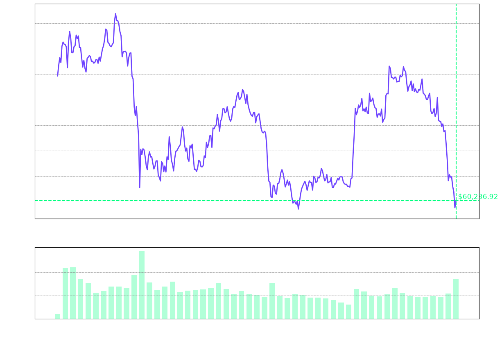

# Hi there, I'm [Zettalynx](https://github.com/Zettalynx) 👋

Welcome to my GitHub profile! Here you'll find various interactive elements and visualizations of Crypto price.

### Bitcoin Price (Last 1 Year)

### Coins

<!--START_SECTION:coins-->

<table style="width: 100%; border-collapse: collapse; color: white;">
  <tr>
    <th style="border: 1px solid white; padding: 10px;">#</th>
    <th style="border: 1px solid white; padding: 10px;">Coin</th>
    <th style="border: 1px solid white; padding: 10px;">Current Price (USD)</th>
    <th style="border: 1px solid white; padding: 10px;">Market Cap (USD)</th>
    <th style="border: 1px solid white; padding: 10px;">24h Volume (USD)</th>
  </tr>
  <tr>
    <td style="border: 1px solid white; padding: 10px;">1</td>
    <td style="border: 1px solid white; padding: 10px;"> Bitcoin (BTC)</td>
    <td style="border: 1px solid white; padding: 10px;">$59,913.00</td>
    <td style="border: 1px solid white; padding: 10px;">$1,205,326,248,215.00</td>
    <td style="border: 1px solid white; padding: 10px;">$27,396,514,789.00</td>
  </tr>
  <tr>
    <td style="border: 1px solid white; padding: 10px;">2</td>
    <td style="border: 1px solid white; padding: 10px;"> Ethereum (ETH)</td>
    <td style="border: 1px solid white; padding: 10px;">$1,662.89</td>
    <td style="border: 1px solid white; padding: 10px;">$203,298,985,351.00</td>
    <td style="border: 1px solid white; padding: 10px;">$10,204,699,999.00</td>
  </tr>
  <tr>
    <td style="border: 1px solid white; padding: 10px;">3</td>
    <td style="border: 1px solid white; padding: 10px;"> Tether (USDT)</td>
    <td style="border: 1px solid white; padding: 10px;">$1.00</td>
    <td style="border: 1px solid white; padding: 10px;">$173,577,270,309.00</td>
    <td style="border: 1px solid white; padding: 10px;">$42,626,261,211.00</td>
  </tr>
  <tr>
    <td style="border: 1px solid white; padding: 10px;">4</td>
    <td style="border: 1px solid white; padding: 10px;"> BNB (BNB)</td>
    <td style="border: 1px solid white; padding: 10px;">$554.28</td>
    <td style="border: 1px solid white; padding: 10px;">$72,893,022,283.00</td>
    <td style="border: 1px solid white; padding: 10px;">$519,117,708.00</td>
  </tr>
  <tr>
    <td style="border: 1px solid white; padding: 10px;">5</td>
    <td style="border: 1px solid white; padding: 10px;"> USDC (USDC)</td>
    <td style="border: 1px solid white; padding: 10px;">$1.00</td>
    <td style="border: 1px solid white; padding: 10px;">$69,425,235,247.00</td>
    <td style="border: 1px solid white; padding: 10px;">$12,783,534,796.00</td>
  </tr>
  <tr>
    <td style="border: 1px solid white; padding: 10px;">6</td>
    <td style="border: 1px solid white; padding: 10px;"> XRP (XRP)</td>
    <td style="border: 1px solid white; padding: 10px;">$0.95</td>
    <td style="border: 1px solid white; padding: 10px;">$60,258,351,305.00</td>
    <td style="border: 1px solid white; padding: 10px;">$1,748,841,080.00</td>
  </tr>
  <tr>
    <td style="border: 1px solid white; padding: 10px;">7</td>
    <td style="border: 1px solid white; padding: 10px;"> Solana (SOL)</td>
    <td style="border: 1px solid white; padding: 10px;">$71.71</td>
    <td style="border: 1px solid white; padding: 10px;">$42,486,030,695.00</td>
    <td style="border: 1px solid white; padding: 10px;">$2,476,637,161.00</td>
  </tr>
  <tr>
    <td style="border: 1px solid white; padding: 10px;">8</td>
    <td style="border: 1px solid white; padding: 10px;"> TRON (TRX)</td>
    <td style="border: 1px solid white; padding: 10px;">$0.30</td>
    <td style="border: 1px solid white; padding: 10px;">$28,549,579,268.00</td>
    <td style="border: 1px solid white; padding: 10px;">$323,001,318.00</td>
  </tr>
  <tr>
    <td style="border: 1px solid white; padding: 10px;">9</td>
    <td style="border: 1px solid white; padding: 10px;"> Figure Heloc (FIGR_HELOC)</td>
    <td style="border: 1px solid white; padding: 10px;">$1.00</td>
    <td style="border: 1px solid white; padding: 10px;">$27,567,930,626.00</td>
    <td style="border: 1px solid white; padding: 10px;">$30,150,685.00</td>
  </tr>
  <tr>
    <td style="border: 1px solid white; padding: 10px;">10</td>
    <td style="border: 1px solid white; padding: 10px;"> Hyperliquid (HYPE)</td>
    <td style="border: 1px solid white; padding: 10px;">$64.35</td>
    <td style="border: 1px solid white; padding: 10px;">$15,291,770,110.00</td>
    <td style="border: 1px solid white; padding: 10px;">$889,695,859.00</td>
  </tr>
</table>

<!--END_SECTION:coins-->

<!--
**Zettalynx/Zettalynx** is a ✨ _special_ ✨ repository because its `README.md` (this file) appears on your GitHub profile.

Here are some ideas to get you started:

- 🔭 I’m currently working on ...
- 🌱 I’m currently learning ...
- 👯 I’m looking to collaborate on ...
- 🤔 I’m looking for help with ...
- 💬 Ask me about ...
- 📫 How to reach me: ...
- 😄 Pronouns: ...
- ⚡ Fun fact: ...
-->
